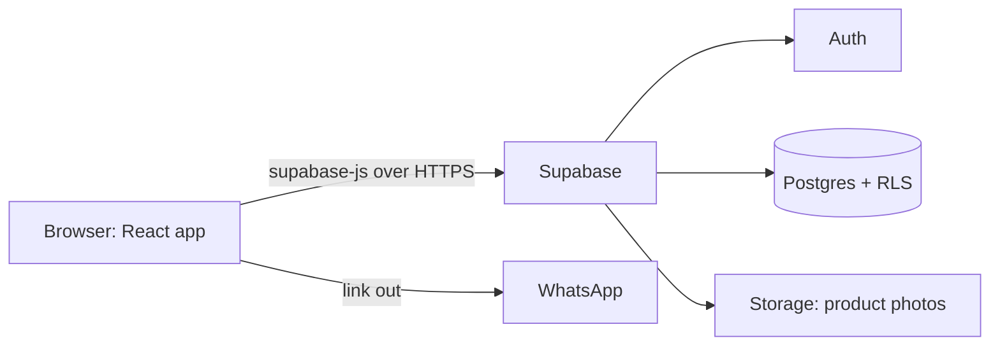

# Universal Market

A request-based online marketplace for quality second-hand tech, appliances and everyday items, built for a retailer in Ibadan, Nigeria.

Customers browse the catalogue and send a purchase request. The owner reviews each request in a private admin dashboard and closes the sale over WhatsApp, which is how most buying and selling already happens locally.

**Live site:** https://universalmarket.ng/

---

## Features

### For customers
- Browse the shop with search, filters and pagination
- Product pages with an image gallery and availability status
- Wishlist that works without an account (saved on the device) and merges into the account when you log in
- Send a request for a listed product, or a custom request for something not listed, as a guest or a logged-in user
- Track your requests and their status under **My requests**
- Sign up, log in, reset your password, edit your profile, and delete your account
- Contact the shop on WhatsApp with a pre-filled message
- Responsive, mobile-first interface

### For the shop owner (admin)
- Role-protected admin area at `/admin`
- Dashboard with request counts and recent activity
- Add, edit, delete, hide and mark products as available or sold
- Image upload with client-side compression (smaller files, less mobile data)
- Review requests, move them through a status workflow (for example Pending, Confirmed, Completed, or Cancelled) and open a WhatsApp chat with a ready-made message

---

## Tech stack

| Area | Tools |
|---|---|
| UI | React 19, Vite, Tailwind CSS 4, shadcn/ui (Radix), Framer Motion, Lucide icons, Sonner |
| Routing | React Router 7 |
| Client state | Redux Toolkit (session, wishlist, UI flow) |
| Server state | TanStack React Query (caching, optimistic updates) |
| Forms and validation | React Hook Form, Zod |
| Backend | Supabase (Auth, Postgres, Storage) |
| Hosting | Vercel |

---

## How it works

There is no custom server. The React app talks directly to Supabase, and **access control is enforced by Row Level Security (RLS) in the database**, not by the React code.



- **Redux** holds what the browser owns: who is logged in, wishlist IDs, modal steps.
- **React Query** holds what the server owns: products and requests, with caching and invalidation.
- **Route guards** (`ProtectedRoute`, `AdminRoute`) control what the UI shows. They are a convenience, not the security boundary. The database rules are.

---

## Project structure

```
src/
├── admin/            Admin area: layout, route guard, pages, hooks, helpers
│   ├── pages/        Dashboard, Products, Requests, forms
│   ├── hooks/        React Query hooks for admin data
│   └── lib/          Image utils, request status rules, WhatsApp messages
├── components/ui/    Shared UI: header, footer, modals, shadcn components
├── features/         Redux slices (auth, wishlist, flow, search)
├── Hooks/            Auth listener, shop and request data hooks
├── Layout/           Page sections: homepage, shop, product page, profile
├── lib/              Zod schemas, redirect helper, WhatsApp config, utils
├── pages/            Route-level pages
├── supabaseClient.js
├── store.js
└── App.jsx           Routes
```

---

## Getting started

### Prerequisites
- A current Node.js LTS (20.19+ or 22.12+ recommended)
- A [Supabase](https://supabase.com) project

### Install and run

```bash
git clone 
cd universal-market
npm install
```

Create a `.env` file in the project root (it is ignored by git):

```
VITE_SUPABASE_URL=https://YOUR-PROJECT.supabase.co
VITE_SUPABASE_PUBLISHABLE_KEY=sb_publishable_xxxxxxxx
VITE_WHATSAPP_NUMBER=234XXXXXXXXXX
```

Then start the dev server:

```bash
npm run dev
```

### Environment variables

| Variable | What it is |
|---|---|
| `VITE_SUPABASE_URL` | Your Supabase project URL |
| `VITE_SUPABASE_PUBLISHABLE_KEY` | The **publishable** (public) key from Supabase API settings |
| `VITE_WHATSAPP_NUMBER` | Business WhatsApp number in international format, for example `2347012345678` |

> Anything starting with `VITE_` is included in the public website code. **Never** put a `service_role` / secret key, a database password or any private token in these variables.

### Scripts

| Command | What it does |
|---|---|
| `npm run dev` | Start the development server |
| `npm run build` | Build for production into `dist/` |
| `npm run preview` | Preview the production build locally |
| `npm run lint` | Run ESLint |

---

## Supabase setup

You need the following in your Supabase project.

**Tables:** `EachProductInformation`, `All_Requests`, `profiles`, `RegUsersWishlists`

**Storage:** a public bucket named `Items images`. Recommended bucket limits: 5 MB maximum file size, allowed types `image/jpeg`, `image/png`, `image/webp`.

**Signup trigger:** a `handle_new_user` trigger on `auth.users` that creates the matching `profiles` row from the signup metadata (`full_name`, `phone_number`). It must **not** copy a role from user-editable metadata.

**Row Level Security** must be switched on for every table. The intended rules:

- Everyone can read products. Only admins can insert, update or delete them.
- Anyone (guest or logged in) can create a request, and a logged-in user may only set their own `user_id`. Customers can read only their own requests. Admins can read, update and delete all requests.
- A user can read, insert, update and delete only their own wishlist row.
- A user can read only their own profile. Profiles cannot be edited from the browser, so nobody can change their own `role`.
- Only admins can upload to the `Items images` bucket.

**Creating the first admin:** sign up normally, then run this in the Supabase SQL editor:

```sql
update public.profiles set role = 'admin' where email = 'you@example.com';
```

> Add your schema and policies as SQL files in a `supabase/` folder so the project can be recreated from scratch.

---

## Deployment (Vercel)

1. Push the repo to GitHub and import it in Vercel.
2. Under **Settings → Environment Variables**, add the three `VITE_` variables for Production, Preview and Development.
3. Deploy. Vite reads variables at build time, so **redeploy** after any change to them.

`vercel.json` contains the single-page-app rewrite and security headers. The Content Security Policy is shipped as `Content-Security-Policy-Report-Only` first. Check the browser console for violations, then rename it to `Content-Security-Policy` to enforce it. If you change your Supabase project URL, update the Supabase host in the policy too.

---

## Security notes

- The database (RLS) is the security boundary. The admin route guard only controls what the interface shows.
- The Supabase publishable key is public by design. The `service_role` key must never be in this repo, in `VITE_` variables or in the browser.
- Roles come only from `profiles.role`, never from user-editable metadata.
- Request images are displayed only when they come from the project's own storage.
- Passwords are handled by Supabase Auth. The app requires 8+ characters with a letter and a number on signup and password reset.
- Account deletion asks for the password first.
- Run `npm audit` regularly and commit `package-lock.json`.

To report a vulnerability, email [SECURITY CONTACT EMAIL] instead of opening a public issue.

---

## Known limitations and roadmap

- [ ] Enforce request `status` defaults and price lookup in the database, not just in the browser
- [ ] Add CAPTCHA and rate limiting for guest requests
- [ ] Hide `is_hidden` products at the database level instead of filtering in the browser
- [ ] Lazy-load admin routes to shrink the customer bundle
- [ ] Add automated tests and a CI workflow
- [ ] Publish a Privacy Notice page at `/privacy`

---

## Contributing

Issues and pull requests are welcome. Please run `npm run lint` and `npm run build` before opening a pull request.

## License

"All rights reserved."

## Author

**Olawale Raji**: www.linkedin.com/in/olawale-raji-aa7997209 / [olawale.](https://olawale-raji.netlify.app/) / olawalesodiq988@gmail.com

## Acknowledgements

- [Supabase](https://supabase.com), [shadcn/ui](https://ui.shadcn.com), [TanStack Query](https://tanstack.com/query), [Redux Toolkit](https://redux-toolkit.js.org)
